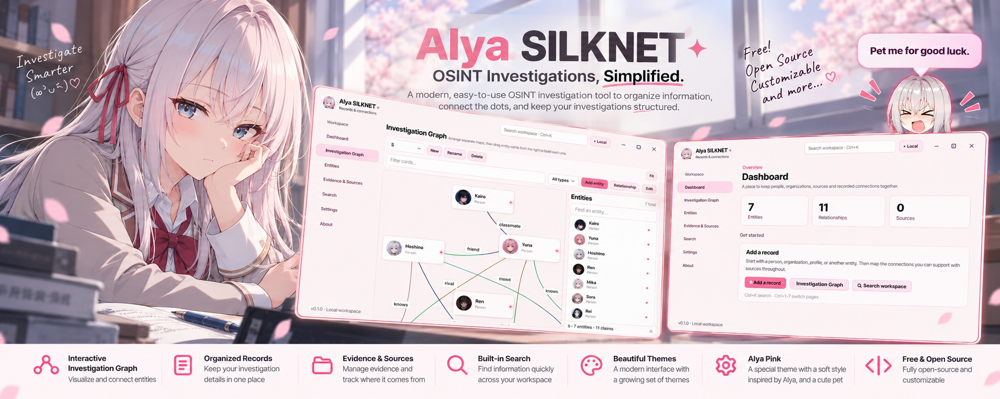

<p align="center">
  
</p>

<h1 align="center">Alya SILKNET ✦</h1>

<p align="center">
  <code>collect clues</code> · <code>connect dots</code> · <code>stay silly</code>
  <br />
  A local-first OSINT workspace for entities, relationship claims, and their sources.
</p>

<p align="center">
  <a href="https://github.com/bn0ky0/Alya-SILKNET/releases/latest"><strong>↓ Download latest release</strong></a>
  · <a href="https://github.com/bn0ky0/Alya-SILKNET">Source code</a>
  · <code>Windows 10+</code>
</p>

---

## `> what_is_this.exe`

Your investigation notebook got a graph upgrade. Keep records, map connections, track sources, and make the messy web of clues a little less messy.

- **Entity vault** — people, profiles, organizations, websites, emails, phone numbers, locations, documents, and custom types.
- **Connection brain** — directional relationship claims with dates, notes, verification status, and confidence notes.
- **Graph mode** — drag nodes, link cards, pan, zoom, filter, and build multiple named workspaces.
- **Source tracking** — attach local sources to entities and claims.
- **Search.exe** — search saved records with type, tag, and verification filters.
- **Import / export** — JSON workspaces and CSV entities, with validation and duplicate checks.
- **Backup button** — ZIP backups include the SQLite database and profile images.

## `> choose_your_theme`

Six appearances: **Dark**, **Light**, **Alya Pink**, **Dark Red**, **Dark Purple**, and **Dark Green**.

Alya Pink comes with floating face-only Alya, a speech bubble, and falling blossoms. Drag the tiny chaos gremlin anywhere on your desktop. Yes, really.

## `> install.exe`

### Just want to use it?

Grab the [latest release](https://github.com/bn0ky0/Alya-SILKNET/releases/latest). Choose the portable ZIP or the per-user installer.

### Running from source

Requires **Python 3.12+**.

```powershell
py -3.12 -m venv .venv
.venv\Scripts\Activate.ps1
python -m pip install --upgrade pip
python -m pip install -e ".[dev]"
python -m silknet
```

### Tests & lint

```powershell
pytest --basetemp=.pytest-tmp
ruff check src tests
ruff format --check src tests
```

### Build for Windows

```powershell
python -m pip install -e ".[build]"
.\scripts\build_windows.ps1
```

Output: `dist\SILKNET\SILKNET.exe` — copy the **whole folder**, not just the EXE.

Need an installer? Install [Inno Setup 6](https://jrsoftware.org/isinfo.php), then run:

```powershell
.\scripts\build_installer.ps1
```

## `> hotkeys.txt`

| Shortcut | Action |
|---|---|
| `Ctrl+K` | Focus workspace search |
| `Ctrl+1` – `Ctrl+7` | Open sidebar pages |
| `Ctrl+B` | Toggle sidebar |
| `F11` | Toggle fullscreen |
| `Esc` | Exit fullscreen / dismiss intro |
| `Space` / `Enter` | Skip intro |
| `Shift` + drag | Link graph cards |
| Right-drag | Pan the graph |

## `> local_only?`

**Your workspace stays on your device.** SILKNET does not run online searches, sync to a server, or send workspace data to analytics. The **About** page checks GitHub Releases for updates; it sends no workspace data. URLs open only when you choose to open them.

A few reality checks:

- Local files are **not encrypted** by SILKNET.
- A name, photo, username, or profile URL does **not** prove who owns an account or what relationships exist.
- JSON exports include local image paths, **not image files**. Use a ZIP backup when moving the whole workspace.
- CSV exports entity rows only; JSON includes entities, claims, sources, and custom entity types.

### Where's my data?

- Database + profile images: `%LOCALAPPDATA%\SILKNET`
- Settings + logs: `%APPDATA%\SILKNET`

Make backups in **Settings → Create backup**. Restoring replaces the open workspace after confirmation and creates a safety backup first.

## `> debug.log`

- App won't launch? Run `python -m silknet` from the source folder.
- Logs live at `%APPDATA%\SILKNET\logs\silknet.log`.
- EXE appears to do nothing? A running instance may already exist; the second launch focuses it.
- Missing profile pics after JSON import? That's expected—JSON doesn't bundle the image bytes. Restore a ZIP backup instead.

## `> project_tree`

```text
src/silknet/core/       models + validation
src/silknet/database/   SQLite + migrations
src/silknet/services/   search, backups, data exchange
src/silknet/graph/      investigation graph
src/silknet/ui/         desktop pages + dialogs
tests/                  tests
```

## `> license`

MIT — see [`LICENSE`](LICENSE).


<p align="center">
  <a href="https://ipn.eg/S/bnoky0/instapay/0GAUXB" target="_blank" rel="noopener noreferrer">
    
  </a>
</p>


<p align="center">
  <code>made for curious brains & suspiciously many tabs</code> 🌸
</p>
